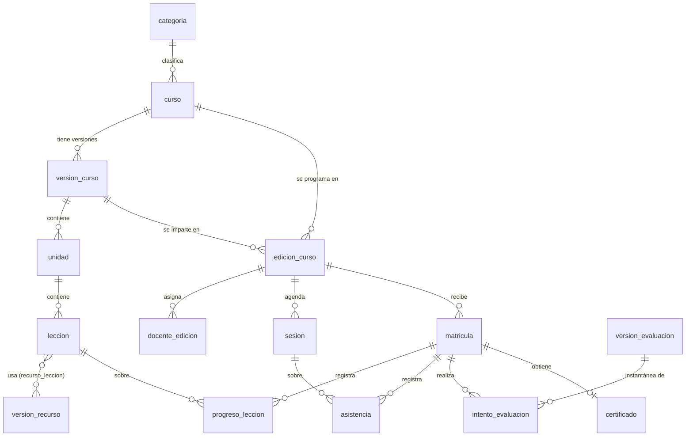
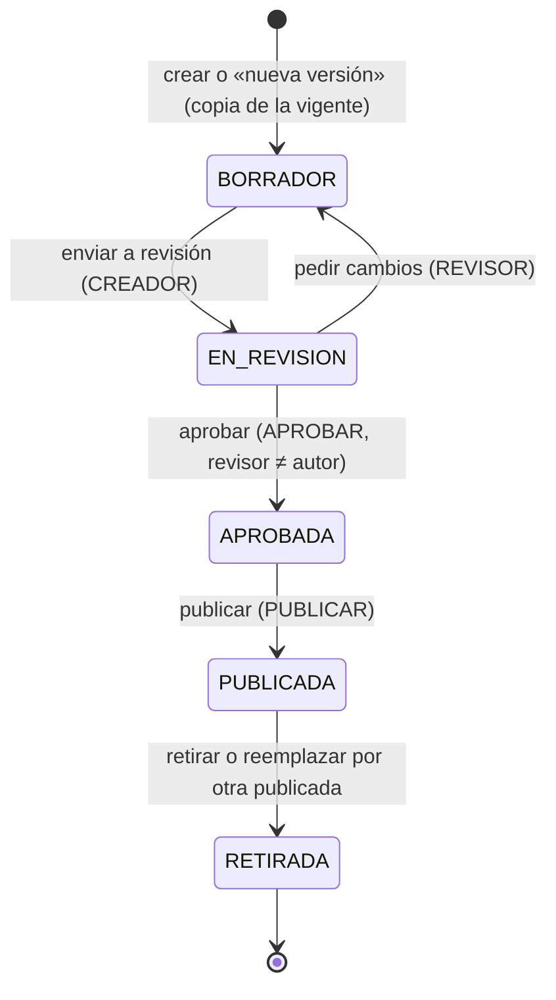
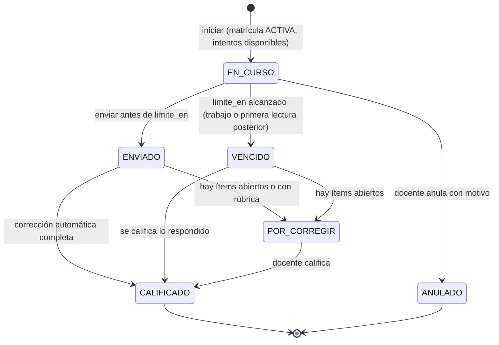

# Modelo de dominio

Las entidades del LMS, sus campos, relaciones, estados e invariantes, decididos **antes** de escribir `model/model.json`
o una migración. Cubre las entidades de la sección 16 de la especificación. Las capacidades que las poseen están en
[overview.md](overview.md); la decisión de modelo híbrido, en
[ADR-0004](../adr/0004-modelo-hibrido-custom-objects-y-tablas-fijas.md).

Nada de esto está implementado. Los nombres de objetos y campos son la propuesta que la tarea 3 del plan (F1) y las
fases siguientes llevan al modelo; un cambio de nombre posterior es una migración de metadata, así que se fijan aquí.

## 1. Convenciones

- **Nombres**: objetos y campos en español, `snake_case`, que cumplan `^[a-z][a-z0-9_]{0,38}$` (regla de Wasichai para
  el nombre de un objeto). Las etiquetas visibles van por i18n.
- **Tipos** de campo de Wasichai: `TEXT`, `LONG_TEXT`, `INTEGER`, `DECIMAL`, `BOOLEAN`, `DATE`, `DATETIME`, `ENUM`, `URL`,
  `UUID`, `RELATION` y, con `wasichai-files`, `FILE`/`IMAGE`. No hay tipo `JSON` (planificado en Wasichai, no existe):
  donde haría falta, o se usa `LONG_TEXT` con JSON canónico que valida una guarda, o una tabla fija `lms` con `jsonb`.
- **Columnas de sistema** que pone Wasichai en cada tabla física: `id`, `organization_id`, `created_at`, `updated_at`,
  `created_by` (verificado en `ObjectSchemaManager.kt`) y `updated_by`. No se repiten en las tablas de abajo.
- **Personas**: una persona es un `users.id` de Wasichai. Los usuarios no son Custom Objects, así que no pueden ser
  destino de un `RELATION`: se guardan en un campo `UUID` (`estudiante_id`, `docente_id`, …) y una guarda comprueba que
  el usuario existe en la organización.
- **Relaciones**: `RELATION` en el lado «muchos» (`MANY_TO_ONE`), con clave foránea real `ON DELETE SET NULL`.
  `ONE_TO_ONE` añade `UNIQUE`. Una relación puede apuntar al mismo objeto (versión anterior, categoría padre).
- **Unicidad**: `unique: true` en un campo o `uniqueConstraints` compuestas (2 a 32 campos). Los `NULL` son distintos
  entre sí, como en PostgreSQL. Una repetición es `409`.
- **Banderas por objeto**: `appendOnly` (sin `UPDATE` ni `DELETE` para nadie, ADMIN y plataforma incluidos), `apiOnly`
  (la API genérica no escribe; solo los comandos LMS) y `requiresReason` (toda escritura lleva `X-Change-Reason`).
- **Leyenda de fase**: F1 = primer incremento (catálogo); F2–F6 según el [roadmap](../product/roadmap.md).

## 2. Cuatro planos que no se mezclan

- **Temario reutilizable** — ¿qué se enseña? `curso`, `version_curso`, `unidad`, `leccion`, `recurso`,
  `version_recurso`, `evaluacion`, `version_evaluacion`, `rubrica`. Cambia cuando un creador prepara una versión nueva;
  lo publicado no cambia.
- **Edición programada** — ¿cuándo, con quién, para cuántos? `edicion_curso`, `docente_edicion`. Se crea al abrir una
  convocatoria y apunta a **una** versión publicada.
- **Sesión** — ¿qué encuentro en vivo ocurre y cuándo? `sesion`, `patron_sesiones`. Cambia al agendar, reprogramar,
  cancelar o recuperar una clase.
- **Progreso individual** — ¿qué hizo esta persona en esta edición? `matricula`, `progreso_leccion`, `asistencia`,
  `intento_evaluacion`, `resultado_evaluacion`, `entrega`, `certificado`. Cambia cuando el estudiante avanza; siempre
  ligado a una matrícula y a una versión.

Un mismo `curso` tiene varias versiones; varias ediciones pueden impartir la misma versión; el progreso de un estudiante
se mide contra la versión de **su** edición, no contra la última versión del curso. Los planos editorial (`revision_contenido`,
`comentario_revision`, `ejecucion_agente`, `artefacto_generado`) y de reputación (`valoracion`, `feedback_contenido`)
cuelgan del temario y de la matrícula respectivamente.

## 3. Custom Object o tabla fija `lms`

Regla ([ADR-0004](../adr/0004-modelo-hibrido-custom-objects-y-tablas-fijas.md)): **Custom Object por defecto**, porque
trae permisos por objeto y acciones declaradas, auditoría, ETag, `RecordWriteGuard`/`RecordReadScope`, pantallas de
administración y API genérica sin código. **Tabla fija** en el esquema `lms` solo si se cumple alguno de estos:

1. El dato es una estructura anidada que debe guardarse y compararse entera (no hay tipo `JSON`).
2. El volumen por usuario es alto y su auditoría fila a fila en `audit_log` no aporta (eventos de aprendizaje).
3. El dato no debe salir nunca por la API genérica ni por el asistente de Wasichai, ni siquiera a ADMIN (claves de
   respuesta antes de tiempo).

| Entidad                                                                   | Almacenamiento                                         | Razón                                         |
| ------------------------------------------------------------------------- | ------------------------------------------------------ | --------------------------------------------- |
| Todas las de §4 salvo las de abajo                                        | Custom Object                                          | Regla por defecto                             |
| Contenido de `version_evaluacion` (preguntas, opciones, claves, puntajes) | `lms.version_evaluacion_contenido` (`jsonb`, `sha256`) | 1 y 3                                         |
| Respuestas de un intento                                                  | `lms.respuesta_intento` (`jsonb` por ítem)             | 1 y 3; el estudiante ve las suyas por comando |
| Eventos de aprendizaje (vídeo, lectura, navegación)                       | `lms.evento_aprendizaje` (solo `INSERT`)               | 2                                             |
| Proyección del catálogo público (solo con la opción B)                    | `lms.catalogo_publicado`                               | [overview §5.1][ov51]                         |

Toda tabla `lms` lleva `organization_id NOT NULL` y cada consulta filtra por él: Wasichai no tiene RLS, así que el
aislamiento es responsabilidad del repositorio y de sus pruebas. El primer incremento no crea ninguna (salvo que se elija
la opción B).

## 4. Entidades

Formato por entidad: objeto, fase, banderas, campos principales (`campo · TIPO · nota`), relaciones e invariantes. Las
invariantes llevan entre corchetes quién las hace cumplir; la tabla completa está en §6.

### 4.1 Catálogo y temario

**`categoria`** — taxonomía del catálogo. F1.
`nombre · TEXT · requerido` · `slug · TEXT · unique` · `descripcion · LONG_TEXT` · `padre · RELATION → categoria` ·
`orden · INTEGER` · `activa · BOOLEAN`.
Invariante: sin ciclos en `padre` [guarda].

**`curso`** (CourseDefinition) — identidad estable de un curso reutilizable, independiente de sus versiones y ediciones. F1.
`codigo · TEXT · unique` · `slug · TEXT · unique, URL pública` · `categoria · RELATION → categoria` ·
`nivel · ENUM(INTRODUCTORIO, INTERMEDIO, AVANZADO)` · `responsable_id · UUID · creador responsable` ·
`version_vigente · RELATION → version_curso · la publicada que muestra el catálogo` ·
`contenido_ilustrativo · BOOLEAN · demo no validada`.
Invariantes: `version_vigente` es una versión de este curso en estado `PUBLICADA` y solo la cambia el comando de
publicar [guarda + servicio]; el `slug` no cambia una vez publicado (rompería enlaces) [guarda].

**`version_curso`** (CourseVersion) — una versión del temario: lo que se revisa, se aprueba y se publica. F1.

- Identidad y estado: `curso · RELATION → curso · requerido` · `numero · INTEGER` · `estado · ENUM(BORRADOR,
EN_REVISION, APROBADA, PUBLICADA, RETIRADA)` · `version_anterior · RELATION → version_curso` · `idioma · TEXT · BCP 47
(es)` · `autor_id · UUID` · `aprobada_por · UUID` · `publicada_en · DATETIME` · `publicada_por · UUID`.
- Contenido de ficha: `titulo · TEXT` · `resumen · LONG_TEXT` · `objetivos · LONG_TEXT` · `resultados_aprendizaje ·
LONG_TEXT` · `conocimientos_previos · LONG_TEXT` · `requisitos · LONG_TEXT` · `evaluacion_resumen · LONG_TEXT` ·
  `certificacion_resumen · LONG_TEXT`.
- Carga académica ([ADR-0007](../adr/0007-carga-academica-y-creditos-como-politica-versionada.md)): `duracion · ENUM` ·
  `semanas · INTEGER` · `horas_teoria_semana · DECIMAL` · `horas_practica_lab_semana · DECIMAL` · `horas_supervisadas_semana · DECIMAL` ·
  `horas_autonomas_semana · DECIMAL`.
- Reglas de finalización (F3): `nota_minima_aprobacion · DECIMAL` · `asistencia_minima_pct · DECIMAL` ·
  `requiere_obligatorias · BOOLEAN`.
- `uniqueConstraints: [[curso, numero]]`.

Invariantes: solo se edita en `BORRADOR`, y con ella sus unidades y lecciones [guarda]; las transiciones son las de §5.1
[guarda + comando]; quien aprueba no es el autor [guarda, F4]; un curso tiene a lo sumo una versión `PUBLICADA` a la vez:
publicar retira la anterior en la misma transacción, bajo `ClusterLock.withXactLock("lms.curso.<id>")` [servicio];
`duracion · ENUM(SEMANAS, SEMESTRAL)` (por defecto `SEMANAS`) y `semanas`: de 1 a 8, o de 12 a 26 si es semestral
(`CourseDurationGuard`, RF-ACA-05) [guarda]; horas ≥ 0. Los créditos **no se guardan** en F1: `workload` los calcula al
leer a partir de las horas y de la política configurada, y la respuesta dice «propuestos», con sistema, método, parámetros,
fuente y versión de la política.

**`unidad`** (LearningUnit) — F1.
`version_curso · RELATION → version_curso · requerido` · `orden · INTEGER` · `titulo · TEXT` · `resumen · LONG_TEXT` ·
`semana_inicio · INTEGER · opcional`.
Invariante: editable solo si su versión está en `BORRADOR` [guarda]. `orden` no es `unique` para poder reordenar en una
transacción; el comando de reordenar deja 1..n sin huecos [servicio].

**`leccion`** (Lesson) — F1 (título y tipo para el temario); contenido F2.
`unidad · RELATION → unidad · requerido` · `orden · INTEGER` · `titulo · TEXT` · `tipo · ENUM(LECTURA, VIDEO,
PRESENTACION, LABORATORIO, EVALUACION)` · `duracion_estimada_min · INTEGER` · `obligatoria · BOOLEAN` ·
`criterio_finalizacion · ENUM(FINALIZACION_EXPLICITA, VIDEO_COMPLETO, EVALUACION_APROBADA, ENTREGA_CALIFICADA)` (F2) ·
`evaluacion · RELATION → evaluacion` (F3, si `tipo = EVALUACION`).
Invariantes: editable solo en versión `BORRADOR` [guarda]; `criterio_finalizacion` coherente con `tipo` (una lectura no
se completa por tiempo abierto) [guarda].

**`recurso`** y **`version_recurso`** (LearningResource) — material reutilizable y versionado, independiente del formato
de salida. F2 (subida de archivos) · F4 (flujo editorial).

- `recurso`: `codigo · TEXT · unique` · `titulo · TEXT` · `descripcion · LONG_TEXT` ·
  `tipo · ENUM(HTML, PDF, VIDEO, PRESENTACION, LABORATORIO, CUESTIONARIO, IMAGEN, DIAGRAMA)` · `idioma · TEXT` ·
  `responsable_editorial_id · UUID`. Una misma `version_recurso` publicada sirve a lecciones de cursos distintos (RF-CON-01).
- `version_recurso`: `recurso · RELATION → recurso` · `numero · INTEGER` · `estado · ENUM` (mismo ciclo que
  `version_curso`) · `fuente_canonica · ENUM(ASCIIDOC, LATEX, HTML, NINGUNA)` · `fuente · FILE` · `origen · TEXT ·
repo@sha:ruta#ancla` · `referencias · LONG_TEXT` · `autor_id · UUID` · `revisada_en · DATETIME`;
  `uniqueConstraints: [[recurso, numero]]`.
- `recurso_leccion`: `leccion · RELATION` · `version_recurso · RELATION` · `orden · INTEGER`;
  `uniqueConstraints: [[leccion, version_recurso]]`. Objeto y no `MANY_TO_MANY` porque el orden importa.

Invariantes: una lección apunta a una **versión** exacta del recurso, nunca al recurso a secas [modelo]; una
`version_recurso` publicada no cambia [guarda]; una lección publicada solo usa versiones de recurso publicadas [guarda].

### 4.2 Edición y sesiones

**`edicion_curso`** (CourseOffering) — una convocatoria con calendario, docentes y cupo. F1.
`curso · RELATION → curso · requerido` · `version_curso · RELATION → version_curso · requerido` · `codigo · TEXT ·
unique` · `modalidad · ENUM(ASINCRONA, SINCRONA, HIBRIDA, PRESENCIAL)` · `zona_horaria · TEXT · IANA, p. ej. America/Lima` ·
`fecha_inicio · DATE` · `fecha_fin · DATE` · `inscripcion_desde · DATETIME` · `inscripcion_hasta · DATETIME` ·
`capacidad · INTEGER · vacío = sin límite` · `estado · ENUM(BORRADOR, PUBLICADA, CANCELADA, FINALIZADA)`.
Invariantes: `version_curso` pertenece a `curso` y está `PUBLICADA` cuando la edición se publica [guarda]; la versión no
cambia una vez hay matrículas [guarda, F2]; `fecha_inicio ≤ fecha_fin`, `inscripcion_desde < inscripcion_hasta`
[guarda]; `zona_horaria` es una región IANA válida [guarda]. «Inscripción abierta» y «en curso» se derivan de las fechas
al leer; no se guardan para que no se desincronicen.

**`docente_edicion`** — asignación de una persona a una edición; es también el alcance del docente. F1.
`edicion · RELATION → edicion_curso · requerido` · `docente_id · UUID` · `rol · ENUM(TITULAR, ASISTENTE)` ·
`nombre_publico · TEXT · lo que muestra el catálogo` · `resumen_publico · LONG_TEXT` · `orden · INTEGER`;
`uniqueConstraints: [[edicion, docente_id]]`.
Invariantes: nadie se asigna a sí mismo [guarda]; el catálogo muestra `nombre_publico`, nunca datos de `users`.
`docente_id` puede quedar vacío en datos de demostración; un perfil público completo del docente llega en F6.

**`patron_sesiones`** — regla que genera sesiones recurrentes. F3.
`edicion · RELATION → edicion_curso` · `dias_semana · TEXT · MO,WE,FR` · `hora_local · TEXT · HH:mm en la zona de la
edición` · `duracion_min · INTEGER` · `desde · DATE` · `hasta · DATE` · `tipo · ENUM` (como `sesion.tipo`) · `docente_id · UUID`.

**`sesion`** (TeachingSession) — un encuentro síncrono concreto. F3.
`edicion · RELATION → edicion_curso · requerido` · `unidad · RELATION → unidad · opcional` · `patron · RELATION →
patron_sesiones · opcional` · `inicio · DATETIME · UTC` · `duracion_min · INTEGER` · `tipo · ENUM(TEORIA, PRACTICA,
LABORATORIO, TUTORIA, EVALUACION)` · `formato · ENUM(PRESENCIAL, VIRTUAL)` · `docente_id · UUID` · `ubicacion · TEXT` ·
`enlace_reunion · URL` · `proveedor_reunion · TEXT · id del adaptador` · `estado · ENUM(PROGRAMADA, REPROGRAMADA,
CANCELADA, REALIZADA)` · `recupera · RELATION → sesion`.
Invariantes: el docente de la sesión está asignado a la edición [guarda]; reprogramar o cancelar exige motivo y avisa a
los matriculados (F3, `wasichai-notifications`) [comando]; una sesión `REALIZADA` con asistencia no se borra [guarda].
El LMS no ofrece videollamada propia: `enlace_reunion` lo pone una persona o un adaptador.

### 4.3 Matrícula, progreso, asistencia y certificados

**`matricula`** (Enrollment) — un estudiante en una edición. F2. `apiOnly`.
`edicion · RELATION → edicion_curso · requerido` · `version_curso · RELATION → version_curso · copiada de la edición` ·
`estudiante_id · UUID` · `estado · ENUM(ACTIVA, RETIRADA, FINALIZADA)` · `resultado · ENUM(SIN_RESULTADO, APROBADO,
NO_APROBADO)` · `matriculado_en · DATETIME` · `finalizado_en · DATETIME`;
`uniqueConstraints: [[edicion, estudiante_id]]`.
Invariantes: se crea dentro de la ventana de inscripción y bajo cupo, contando bajo
la fila de `lms.ocupacion_edicion` bloqueada con `FOR UPDATE` en la transacción del alta para que dos altas
simultáneas no pasen el cupo (ADR-0013) [servicio];
`version_curso` = la de la edición y no cambia [guarda]; `resultado` lo fija la regla de finalización, no una persona
[servicio, F3].

**`progreso_leccion`** (LearningProgress) — estado de una lección para una matrícula. F2. `apiOnly`: solo lo escribe
el aula (`POST …/lessons/{id}/events`).
`matricula · RELATION → matricula · requerido` · `leccion · RELATION → leccion · requerido` · `estudiante_id · UUID ·
indexado` (para el alcance) · `estado · ENUM(INICIADA, COMPLETADA, APROBADA)` · `evidencia ·
ENUM(FINALIZACION_EXPLICITA, FIN_DE_VIDEO)` (F3 añade la de evaluación y entrega) · `iniciado_en · DATETIME` ·
`completado_en · DATETIME`; `uniqueConstraints: [[matricula, leccion]]`.
Invariantes [servicio, `LessonProgressService`]: solo el estudiante, sobre su matrícula `ACTIVA` y una lección de la
`version_curso` de esa matrícula; el estado solo avanza; lectura, presentación y laboratorio se completan cuando el
estudiante la marca, vídeo al terminar la reproducción, evaluación y sesión en F3; un cerrojo consultivo por (matrícula,
lección) serializa los eventos simultáneos. Lectura por `estudiante_id` (`EnrollmentReadScope`), salvo `VER_TODAS`. El
progreso por unidad y total se calcula, no se guarda. Cada evento aceptado va a `lms.evento_aprendizaje`, una vez por
`clientEventId`, en la misma transacción; el tiempo con la página abierta no cuenta como evidencia.

**`asistencia`** (AttendanceRecord) — F3. `requiresReason`.
`sesion · RELATION → sesion` · `matricula · RELATION → matricula` · `estado · ENUM(PRESENTE, TARDE, AUSENTE,
JUSTIFICADO)` · `fuente · ENUM(DOCENTE, PROVEEDOR)` · `registrado_por · UUID`;
`uniqueConstraints: [[sesion, matricula]]`.
Invariantes: sesión y matrícula son de la misma edición [guarda]; solo un docente de esa edición la registra [alcance +
guarda]. Asistencia en vivo y progreso de materiales son cosas distintas y no se derivan una de otra.

**`certificado`** (Certificate) — F3. `appendOnly`.
`matricula · RELATION → matricula · ONE_TO_ONE` · `codigo_verificacion · TEXT · unique` · `emitido_en · DATETIME` ·
`regla_aplicada · TEXT · versión de la regla de finalización` · `documento_id · UUID · documento de wasichai-documents`.
Revocar crea un `revocacion_certificado` (`certificado`, `motivo`, `revocado_por`), también `appendOnly`.
Invariantes: solo se emite con `matricula.resultado = APROBADO` [servicio]; el documento queda congelado al emitirse
(comportamiento de `wasichai-documents`).

### 4.4 Evaluaciones

**`evaluacion`** (AssessmentDefinition) — F3.
`version_curso · RELATION → version_curso` · `titulo · TEXT` · `tipo · ENUM(CUESTIONARIO, ENTREGA, LABORATORIO)` ·
`peso · DECIMAL` · `nota_minima · DECIMAL` · `intentos_max · INTEGER` · `tiempo_limite_min · INTEGER` ·
`orden_aleatorio · BOOLEAN` · `mostrar_respuestas · ENUM(NUNCA, TRAS_ENVIO, TRAS_CIERRE)` · `rubrica · RELATION → rubrica`.

**`version_evaluacion`** (AssessmentVersion) — F3.
Custom Object: `evaluacion · RELATION` · `numero · INTEGER` · `estado · ENUM(BORRADOR, PUBLICADA, RETIRADA)` ·
`sha256 · TEXT · del contenido`. Contenido en `lms.version_evaluacion_contenido` (§3).
Invariante: publicada, ni la cabecera ni el contenido cambian; corregir una pregunta es una versión nueva [guarda +
repositorio sin `UPDATE`].

**`intento_evaluacion`** (AssessmentAttempt) — F3. `apiOnly`.
`matricula · RELATION` · `version_evaluacion · RELATION · la instantánea exacta` · `numero · INTEGER` · `estado ·
ENUM` (§5.2) · `iniciado_en · DATETIME` · `limite_en · DATETIME` · `enviado_en · DATETIME` · `semilla_orden · INTEGER`;
`uniqueConstraints: [[matricula, version_evaluacion, numero]]`. Respuestas en `lms.respuesta_intento`.
Invariantes: se abre solo con matrícula `ACTIVA` y `numero ≤ intentos_max` [servicio]; queda atado a la
`version_evaluacion` y al `sha256` vigentes al abrirlo aunque después se publique otra [guarda]; el servidor rechaza
respuestas después de `limite_en` según su propio reloj [servicio]; las claves no salen antes de lo que diga
`mostrar_respuestas` [servicio; nunca están en un Custom Object].

**`resultado_evaluacion`** (AssessmentResult) — F3. `appendOnly`, `requiresReason`.
`intento · RELATION → intento_evaluacion` · `puntaje · DECIMAL` · `aprobado · BOOLEAN` · `origen · ENUM(AUTOMATICO,
MANUAL)` · `calificado_por · UUID` · `comentario · LONG_TEXT` · `reemplaza · RELATION → resultado_evaluacion`.
Puntajes por criterio de rúbrica en `resultado_criterio` (`resultado`, `criterio`, `puntaje`, `comentario`), también
`appendOnly`.
Invariantes: corregir una nota agrega un resultado que `reemplaza` al anterior; el vigente es el último; el historial
completo queda [`appendOnly`]; solo un docente de la edición califica [alcance + guarda]. El resultado de una prueba no
es la aprobación del curso: esa la decide la regla de finalización sobre `matricula`.

**`entrega`** (AssignmentSubmission) — F3. `appendOnly`.
`matricula · RELATION` · `evaluacion · RELATION` · `numero · INTEGER` · `archivo · FILE` · `enlace · URL` ·
`comentario · LONG_TEXT` · `enviada_en · DATETIME`; `uniqueConstraints: [[matricula, evaluacion, numero]]`.
Invariante: reenviar crea otra entrega; ninguna se sobrescribe [`appendOnly`]. La calificación es un
`resultado_evaluacion`.

**`rubrica`** y **`criterio_rubrica`** (Rubric) — F3.
`rubrica`: `titulo · TEXT` · `version_curso · RELATION`. `criterio_rubrica`: `rubrica · RELATION` · `orden · INTEGER` ·
`nombre · TEXT` · `descriptores · LONG_TEXT · niveles y descripción` · `puntaje_max · DECIMAL`.
Invariante: no cambia mientras haya resultados que la usen [guarda].

### 4.5 Flujo editorial e IA

**`revision_contenido`** (ContentReview) — F4.
`version_curso · RELATION` · `version_recurso · RELATION` · `revisor_id · UUID` · `solicitada_por · UUID` · `estado ·
ENUM(ASIGNADA, EN_CURSO, CAMBIOS_SOLICITADOS, APROBADA, RECHAZADA)` · `decidida_en · DATETIME`.
Invariantes: exactamente una de las dos versiones [guarda]; `revisor_id` ≠ autor de la versión cuando la política exige
revisión independiente [guarda]; las decisiones quedan en `audit_log` con motivo (`X-Change-Reason`). Usar
`wasichai-workflow` para sus estados se evalúa en F4.

**`comentario_revision`** (ReviewComment) — F4.
`revision · RELATION → revision_contenido` · `autor_id · UUID` · `ancla · TEXT · sección o fragmento` · `texto ·
LONG_TEXT` · `severidad · ENUM(OBSERVACION, RECOMENDACION, BLOQUEANTE)` · `estado · ENUM(ABIERTO, ATENDIDO, DESCARTADO)`.
Invariantes: `texto` no cambia tras crearse; solo `estado` avanza [guarda]; una versión con comentarios `BLOQUEANTE`
abiertos no se aprueba [guarda].

**`ejecucion_agente`** (AgentRun) — F5. `apiOnly`.
`usuario_id · UUID` · `version_curso · RELATION` · `unidad · RELATION` · `objetivo · TEXT` · `entradas · LONG_TEXT` ·
`fuentes · LONG_TEXT` · `proveedor · TEXT` · `modelo · TEXT` · `version_instrucciones · TEXT` · `version_plantilla ·
TEXT` · `resultado · LONG_TEXT · JSON validado` · `validaciones · LONG_TEXT` · `estado · ENUM(EN_COLA, EN_PROCESO,
COMPLETADA, REQUIERE_CORRECCION, FALLIDA, CANCELADA)` · `error · LONG_TEXT` · `tokens_entrada · INTEGER` ·
`tokens_salida · INTEGER` · `coste · DECIMAL` · `duracion_ms · INTEGER` · `intentos · INTEGER` ·
`clave_idempotencia · TEXT · unique`.
Invariantes: sin secretos en ningún campo [servicio]; repetir con la misma clave no crea otra ejecución [`unique`]; una
ejecución nunca publica [diseño]. Diseño completo en [docs/ai](../ai/README.md).

**`artefacto_generado`** (GeneratedArtifact) — F4 (HTML/PDF) · F5 (vídeo). `appendOnly`.
`version_recurso · RELATION` · `formato · ENUM(HTML, PDF, MP4, VTT, PNG, SVG)` · `archivo · FILE · trae sha256` ·
`generador · TEXT` · `version_generador · TEXT` · `parametros · LONG_TEXT` · `ejecucion · RELATION → ejecucion_agente` ·
`validado · BOOLEAN`.
Invariante: un artefacto publicado nunca se sobrescribe; regenerar crea otro [`appendOnly`]. Mientras un artefacto
apunte a una `version_recurso`, esa versión no se puede borrar (regla de Wasichai para destinos de objetos `appendOnly`).

### 4.6 Reputación y auditoría

**`valoracion`** (Rating) — F6.
`matricula · RELATION` · `docente_edicion · RELATION` · `version_recurso · RELATION` · `comentario · LONG_TEXT` ·
`estado_moderacion · ENUM(PENDIENTE, PUBLICADA, OCULTA)`; puntajes por dimensión configurable en `puntaje_valoracion`
(`valoracion`, `dimension`, `valor · INTEGER`).
`uniqueConstraints: [[matricula, docente_edicion], [matricula, version_recurso]]` (con `NULL` distintos, cada par
impide su duplicado sin chocar con el otro).
Invariantes: solo valora quien tiene esa matrícula [guarda]; exactamente un destino [guarda]; nunca un visitante.

**`feedback_contenido`** (Feedback) — F6.
`autor_id · UUID` · `matricula · RELATION` · `version_curso · RELATION` · `unidad · RELATION` · `leccion · RELATION` ·
`texto · LONG_TEXT` · `estado · ENUM(ABIERTO, EN_REVISION, RESUELTO, DESCARTADO)` · `respuesta · LONG_TEXT`.

**AuditRecord** — no es un objeto del LMS: es `audit_log` de Wasichai (append-only en la base, con usuario, operación,
antes/después, motivo y correlación). Las escrituras de trabajos en segundo plano usan `asPlatform(org, "job:<nombre>")`
para que el origen quede en la auditoría.

## 5. Ciclos de vida

### 5.1 Versión de curso

- Solo `BORRADOR` es editable, junto con sus unidades y lecciones. «Nueva versión» copia la vigente con
  `version_anterior` y `numero + 1`; no es una transición de la publicada.
- Publicar, en una transacción: pasa a `PUBLICADA`, retira la publicada anterior del curso y apunta
  `curso.version_vigente` a la nueva.
- Las transiciones solo las hace el comando correspondiente; un `PUT` genérico que cambie `estado` lo rechaza la guarda.
- En F1 no hay flujo de revisión: los datos de demostración llegan publicados por el script de siembra. Cómo recorre la
  siembra los estados sin abrir un atajo en la guarda se fija en la tarea 3 (a verificar).

`version_recurso` y `version_evaluacion` siguen el mismo principio con un ciclo más corto.

### 5.2 Intento de evaluación

`limite_en = iniciado_en + tiempo_limite_min` lo calcula el servidor al abrir. Un intento `CALIFICADO` no vuelve atrás:
una recalificación agrega un `resultado_evaluacion` nuevo.

### 5.3 Otros estados

- `edicion_curso`: `BORRADOR → PUBLICADA → FINALIZADA`, y `BORRADOR|PUBLICADA → CANCELADA` (con aviso a matriculados).
- `matricula`: `ACTIVA → RETIRADA | FINALIZADA`.
- `sesion`: `PROGRAMADA → REPROGRAMADA → … → REALIZADA`, y `PROGRAMADA|REPROGRAMADA → CANCELADA` (puede tener una
  `recupera`).
- `ejecucion_agente`: el de su enum; reintentos con tope y cancelación entre pasos ([overview §6](overview.md#6-trabajos-asíncronos)).

## 6. Invariantes y quién las hace cumplir

Mecanismos de Wasichai, verificados en su código (`wasichai-core/.../data/RecordWriteGuard.kt`, `RecordReadScope.kt`,
ADR-040 de Wasichai), y su uso en el LMS:

- **`RecordWriteGuard.beforeWrite(RecordWrite)`** se llama **antes** de guardar en toda vía de escritura: API genérica,
  `RecordService`, enlaces, transiciones de workflow y acciones de automatización; para todo usuario, ADMIN y plataforma
  incluidos. Recibe `kind`, `before` y `attributes`. Una excepción aborta: nada se guarda, audita ni notifica. Corre en
  la transacción del que llama y **no bloquea nada**.
  Uso: estados y transiciones, edición solo en `BORRADOR`, pertenencia (lección ↔ versión de la matrícula), sin
  autoasignación ni autoaprobación.
- **`RecordReadScope.criterion(caller, definition)`** devuelve un criterio SQL que se suma con `AND` a toda lectura del
  objeto; fuera de él el registro «no existe» (`404`). Se pregunta por personas y cuentas de servicio, **nunca** por
  ADMIN, la plataforma ni automatizaciones. Varias implementaciones se combinan con `AND`.
  Uso: el estudiante lee sus matrículas, progreso e intentos; el docente, lo de sus ediciones (`docente_edicion`); el
  revisor, sus revisiones; quien no puede editar versiones solo lee las `PUBLICADA`.
- **`appendOnly`**: `UPDATE`, `DELETE`, transición y enlace/desenlace responden `409` a todos. Borrar un registro al que
  apunta uno `appendOnly` también es `409`. No es un permiso de base de datos: SQL directo contra la tabla física no
  queda frenado.
  Uso: `certificado`, `revocacion_certificado`, `resultado_evaluacion`, `resultado_criterio`, `entrega`,
  `artefacto_generado`.
- **`apiOnly`**: la API genérica responde `403` a las escrituras (ADMIN incluido); `RecordService` en proceso sí escribe.
  Uso: `matricula`, `progreso_leccion`, `intento_evaluacion`, `ejecucion_agente`.
- **`requiresReason`**: toda escritura sin motivo es `400`. Uso: `asistencia`, `resultado_evaluacion`.
- **`RELATION`**: el destino debe ser de la misma organización y legible para quien escribe; si no, `400`. Evita
  enlazar con registros de otra organización o fuera del alcance.
- **`uniqueConstraints`**: `UNIQUE` real; repetir es `409`. Uso: una matrícula por persona y edición, un progreso por
  lección, claves de idempotencia.

Las guardas LMS no comparan nombres de rol: cuando una regla depende de quién es la persona, consultan una asignación
(`docente_edicion`, `revision_contenido.revisor_id`) o un permiso (`CurrentUser.requirePermission`). El alcance de
lectura resuelve primero las asignaciones de quien llama (suspendiendo, una vez por petición) y luego devuelve
`campo IN (ids ligados)`, como hace sgspe en `scope/AssignedQuery.kt`. Como la guarda no bloquea, las invariantes que
dependen de contar o de otro registro (cupo, una sola versión publicada) se protegen con
`ClusterLock.withXactLock` dentro de la transacción del comando.

## 7. Reglas de consistencia de la sección 16

| Regla                                         | Cómo se cumple                                                                                                  |
| --------------------------------------------- | --------------------------------------------------------------------------------------------------------------- |
| Lo publicado es inmutable                     | Guarda: las versiones y sus hijos solo cambian en `BORRADOR`; artefactos `appendOnly`; corregir = versión nueva |
| La matrícula identifica la edición            | `matricula.edicion` requerido + `uniqueConstraints [edicion, estudiante_id]`                                    |
| El progreso se liga a matrícula y versión     | `progreso_leccion.matricula` + guarda: la lección es de `matricula.version_curso`, fijada al matricular         |
| El intento usa la versión exacta de la prueba | `intento_evaluacion.version_evaluacion` + `sha256`; el contenido está en una tabla sin `UPDATE`                 |
| Aprobación por reglas explícitas              | Reglas de finalización versionadas en `version_curso`; aprobar una prueba no aprueba el curso                   |
| Créditos con su método                        | `CreditProposal` con sistema, método, parámetros, fuente y versión; propone, no aprueba ([ADR-0007][adr7])      |
| Transacciones donde corresponda               | Comandos de varios registros en una transacción (`RecordService` se une a ella)                                 |
| Asíncronos recuperables sin duplicados        | Registro como cola con `clave_idempotencia` única y reintentos con tope ([overview §6][ov6])                    |
| Sin acceso cruzado entre organizaciones       | Tabla física por organización, organización del JWT; tablas `lms` filtradas por `organization_id`               |
| Sin acceso cruzado entre usuarios o cursos    | `RecordReadScope` por asignación + guardas; pruebas de IDOR ([security](../security/README.md))                 |

No hay conversión entre ECTS y SCH.

[adr7]: ../adr/0007-carga-academica-y-creditos-como-politica-versionada.md
[ov6]: overview.md#6-trabajos-asíncronos
[ov51]: overview.md#51-la-petición-anónima-del-catálogo-a-verificar

## 8. Fechas y zonas horarias

- Un instante (`inicio` de sesión, `iniciado_en`, ventanas de inscripción) es `DATETIME`: `timestamptz`, viaja en UTC.
- Un día del calendario de la edición (`fecha_inicio`, `fecha_fin`, `patron_sesiones.desde/hasta`) es `DATE`, entendido
  en la zona de la edición.
- La zona de la edición es `edicion_curso.zona_horaria`, un `TEXT` con región IANA validado por guarda. No se usa el
  `timeZone` de campo de Wasichai porque es **uno por campo** y aquí cada edición tiene la suya; tampoco desplazamientos
  fijos (`-05:00`), que no siguen el horario de verano.
- Generar sesiones recurrentes: para cada fecha del patrón, `LocalDate + hora_local` en `ZoneId(zona_horaria)` → instante
  UTC. Así una clase «a las 19:00 en Madrid» sigue siendo a las 19:00 locales a ambos lados del cambio de hora. Un hueco de
  horario de verano (la hora no existe) se desplaza hacia adelante y una hora repetida toma el primer desplazamiento
  (comportamiento de `ZonedDateTime.of`); se fija con pruebas en F3.
- La UI muestra las sesiones en la zona de la edición y, si difiere, también en la del navegador.

## 9. Qué entra en cada fase

- **F1 — primer incremento (catálogo)**: `categoria`, `curso`, `version_curso` (ficha y carga), `unidad`, `leccion`
  (título, tipo, duración), `edicion_curso`, `docente_edicion`.
- **F2 — aula**: `matricula`, `progreso_leccion`, `recurso`, `version_recurso`, `recurso_leccion`,
  `lms.evento_aprendizaje`. Decidido en [ADR-0012](../adr/0012-aula-del-estudiante.md): la matrícula
  se crea por comando; un `RecordReadScope` limita a quien no tiene la acción declarada `VER_TODAS` (DOCENTE, CREADOR y
  REVISOR la tienen) a sus matrículas y al contenido de las versiones en que está matriculado; el HTML se muestra en un
  `iframe` aislado; el progreso exige la evidencia de su tipo de lección.
- **F3 — evaluación y operación docente**: `evaluacion`, `version_evaluacion` (+ `lms.version_evaluacion_contenido`),
  `intento_evaluacion` (+ `lms.respuesta_intento`), `resultado_evaluacion`, `resultado_criterio`, `entrega`, `rubrica`,
  `criterio_rubrica`, `patron_sesiones`, `sesion`, `asistencia`, `certificado`, `revocacion_certificado`; reglas de
  finalización en `version_curso`.
- **F4 — estudio editorial**: `revision_contenido`, `comentario_revision`, `artefacto_generado` (HTML/PDF); ciclo
  completo de §5.1.
- **F5 — IA y multimedia**: `ejecucion_agente`, `artefacto_generado` (vídeo, subtítulos).
- **F6 — calidad y reputación**: `valoracion`, `puntaje_valoracion`, `feedback_contenido`, aprobación humana de
  créditos, perfil público del docente.

## 10. A verificar en implementación

- La vía de lectura del catálogo anónimo ([overview §5.1](overview.md#51-la-petición-anónima-del-catálogo-a-verificar)):
  `asPlatform` no se puede usar dentro de una petición.
- Que `apply.py` pueda declarar `uniqueConstraints`, `appendOnly`, `apiOnly` y `requiresReason` por REST en el mismo
  paso que crea el objeto (los campos existen en `POST /api/objects` según la documentación de Wasichai).
- Cómo valida una guarda que un `UUID` de persona existe en la organización sin usar APIs internas de Wasichai.
- Cómo recorre la siembra de demostración los estados de `version_curso` sin un atajo en la guarda.
- Si `revision_contenido` gana algo con `wasichai-workflow` frente a un `ENUM` cambiado por comandos (F4).
