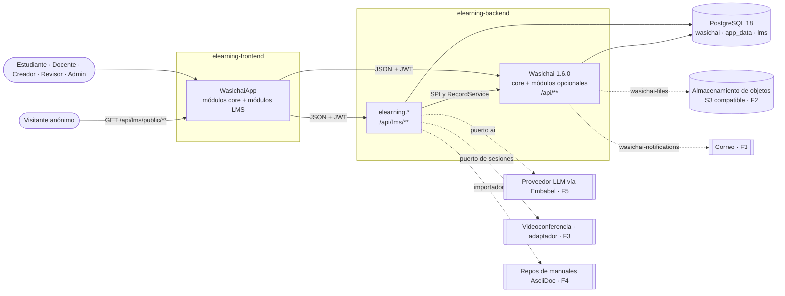
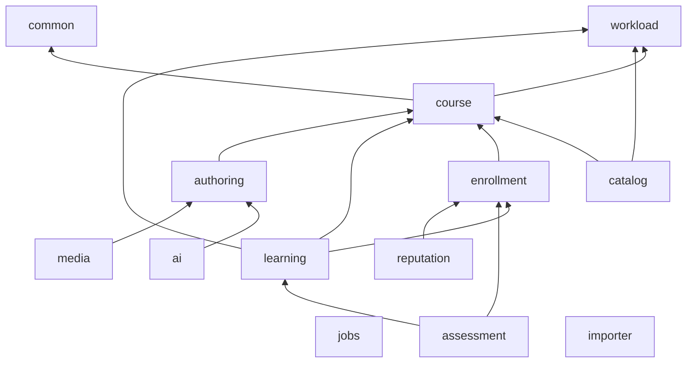
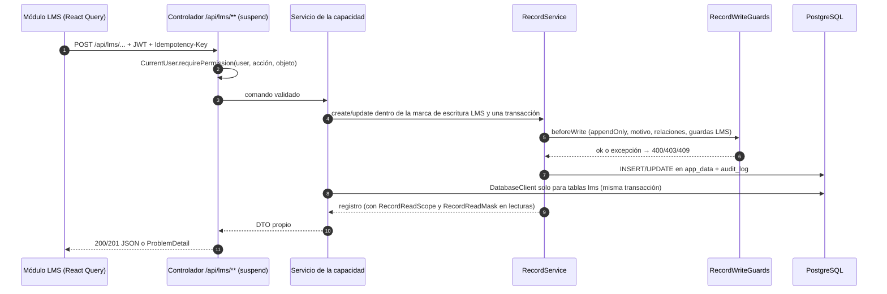

# Arquitectura: vista general

Cómo se arma wasichai-learning sobre Wasichai: qué piezas hay, qué hace cada una, qué puede depender de qué y por dónde
pasa una petición. El modelo de datos está en [domain-model.md](domain-model.md); las razones de cada decisión, en los
[ADR](../adr/README.md); los hechos de Wasichai que se citan aquí, en
[reference-repositories.md](../research/reference-repositories.md).

Estado: **Fase 0**. Solo existe el wrapper de Gradle. Todo lo demás es diseño: «planificado (Fx)» indica la fase del
[roadmap](../product/roadmap.md) en que llega, y «a verificar» lo que se confirma al implementar.

## 1. Contexto

Wasichai es la plataforma: identidad, organizaciones, metadatos (Custom Objects), registros, permisos, auditoría,
REST, y módulos opcionales (files, notifications, automation, workflow, documents, agent). wasichai-learning es una
**aplicación** sobre ella, no un fork ni una capa paralela: lo que Wasichai ya resuelve se usa; lo que falta se agrega
por sus SPI. Dos repositorios:

- **`elearning-backend`** (este): app Spring Boot `@WasichaiApplication`, paquete raíz `elearning`, `model/` (metadata) y
  la documentación de arquitectura. Consume `wasichai:wasichai-bom:1.6.0` y sus starters
  ([ADR-0002](../adr/0002-wasichai-desde-github-packages.md)).
- **`elearning-frontend`**: app Vite con `<WasichaiApp>` y los módulos LMS por experiencia. Consume
  `@wasichai/{core,ui,testing}` 1.3.0.

La documentación de producto y arquitectura vive en este repositorio; el frontend la enlaza.

Las líneas punteadas son integraciones que llegan en fases posteriores y que el núcleo ve solo como puertos: el dominio no
depende de un proveedor concreto de IA, almacenamiento o videoconferencia.

## 2. Capacidades del backend

Monolito modular: un proyecto Gradle, un paquete por **capacidad** bajo `elearning`
([ADR-0003](../adr/0003-monolito-modular-y-modulos-ui-por-experiencia.md)). Cada capacidad es dueña de sus objetos del
modelo, sus guardas, sus alcances de lectura y sus comandos en `/api/lms/**`. Las entidades de cada una están en
[domain-model.md](domain-model.md).

### 2.1 Responsabilidad y contratos

| Capacidad                       | Responsabilidad                                                                                           | Contratos públicos                                | Fase               |
| ------------------------------- | --------------------------------------------------------------------------------------------------------- | ------------------------------------------------- | ------------------ |
| `common`                        | Permisos (`CurrentUser`), marca de escritura propia, errores `ProblemDetail`, cadena de seguridad pública | Ninguno propio                                    | F1                 |
| `workload`                      | Dominio puro: horas de contacto/autónomas/totales, `CreditPolicy` → `CreditProposal`                      | API Kotlin, sin HTTP                              | F1                 |
| `jobs`                          | Cola persistente `lms.trabajo`: encolar, reclamar con `SKIP LOCKED`, reintentos con tope (§6)             | `JobQueue`, puerto `JobHandler`; sin HTTP         | F4                 |
| `course`                        | Curso, versión, unidad, lección, edición, docentes, sesiones                                              | `/api/lms/courses/**`, `/api/lms/offerings/**`    | F1 · F3 (sesiones) |
| `catalog`                       | Lectura pública de lo publicado; búsqueda, filtros, orden                                                 | `GET /api/lms/public/catalog/**`                  | F1                 |
| `enrollment`                    | Matrícula, capacidad, ventana de inscripción                                                              | `/api/lms/enrollments/**`                         | F2                 |
| `learning`                      | Aula, progreso, eventos de aprendizaje, asistencia, finalización, certificados                            | `/api/lms/classroom/**`                           | F2 · F3            |
| `assessment`                    | Evaluaciones, versiones e instantáneas, intentos, entregas, rúbricas, resultados                          | `/api/lms/assessments/**`, `/api/lms/attempts/**` | F3                 |
| `authoring`                     | Recursos versionados, revisión, comentarios, publicación, importador AsciiDoc                             | `/api/lms/authoring/**`, `/api/lms/reviews/**`    | F4                 |
| `ai`                            | Canalización editorial con Embabel, `AgentRun`, doble determinista                                        | `/api/lms/ai/**`                                  | F5                 |
| `media`                         | Renderizado (HTML, PDF, Remotion), artefactos generados                                                   | `/api/lms/media/**`                               | F4 · F5            |
| `reputation` (nombre propuesto) | Valoraciones y feedback contextual                                                                        | `/api/lms/ratings/**`, `/api/lms/feedback/**`     | F6                 |

Las rutas son el prefijo previsto; el contrato exacto se documenta con springdoc al implementarlo
([ADR-0008](../adr/0008-openapi-con-springdoc.md)). Además de sus comandos, toda capacidad expone sus Custom Objects por
la API genérica de Wasichai (`/api/objects/{o}/records`) salvo los marcados `apiOnly` ([domain-model §6][dm6]).

### 2.2 Persistencia, permisos, trabajos y frontend

| Capacidad    | Migraciones / modelo                 | Permisos y alcance                                   | Eventos y trabajos                        | Módulo UI (`<x>Module`)         |
| ------------ | ------------------------------------ | ---------------------------------------------------- | ----------------------------------------- | ------------------------------- |
| `common`     | —                                    | Acciones declaradas por objeto; nunca nombres de rol | —                                         | —                               |
| `workload`   | —                                    | —                                                    | —                                         | —                               |
| `jobs`       | `lms.trabajo`                        | — (lo comprueba quien encola)                        | Ejecuta los trabajos de los demás         | —                               |
| `course`     | Objetos                              | `PUBLICAR`, `APROBAR`; docente por `docente_edicion` | Aviso de cambio de calendario (F3)        | `catalog`, `teaching`, `studio` |
| `catalog`    | — (lee los de `course`)              | Anónimo, solo `GET`, solo lo publicado               | —                                         | `catalog`                       |
| `enrollment` | Objetos                              | Estudiante: sus matrículas                           | Notificación de matrícula                 | `classroom`, `teaching`         |
| `learning`   | Objetos + `lms.evento_aprendizaje`   | Estudiante: lo suyo; docente: su edición             | Finalización; emisión de certificado      | `classroom`, `teaching`         |
| `assessment` | Objetos + tablas `lms`               | Docente de la edición; con motivo                    | Vencimiento de intentos; corrección       | `classroom`, `teaching`         |
| `authoring`  | Objetos                              | Revisor: sus revisiones; sin autoaprobación          | Importación (trabajo); avisos de revisión | `studio`, `review`              |
| `ai`         | Objeto `ejecucion_agente`            | Generar ≠ validar ≠ aprobar ≠ publicar               | Ejecuciones en cola persistente           | `studio`                        |
| `media`      | Objeto `artefacto_generado` + `FILE` | Hereda del recurso                                   | Renderizado en cola persistente           | `studio`                        |
| `reputation` | Objetos                              | Solo matriculados valoran; moderación                | Agregados periódicos                      | `classroom`, `teaching`         |

«Objetos» son Custom Objects aplicados por `model/apply.py`. Las tablas fijas del esquema `lms` se crean con
`ModuleMigration("lms", "classpath:db/lms", 200)` ([ADR-0004](../adr/0004-modelo-hibrido-custom-objects-y-tablas-fijas.md));
ninguna en el primer incremento. Las pruebas de cada capacidad están en [testing](../testing/README.md); el modelo de
amenazas, en [security](../security/README.md).

### 2.3 Dependencias permitidas y prohibidas

Una flecha `A --> B` significa «A puede usar B». Todo paquete puede usar `common`; se omite para no cargar el diagrama.
`workload` no depende de nada (ni Spring ni Wasichai). Cuando una capacidad inferior necesita un dato de una superior,
la inferior declara un puerto y la superior lo implementa: por ejemplo, el cupo disponible que muestra el catálogo es un
puerto de `course` implementado por `enrollment` (F2).

| Regla                                                                                                | Comprobación                                                                     |
| ---------------------------------------------------------------------------------------------------- | -------------------------------------------------------------------------------- |
| Sin ciclos entre capacidades; solo las flechas del diagrama                                          | `ArchitectureTest` (escaneo de fuentes, como `CoreArchitectureTest` de Wasichai) |
| Nada bajo el paquete `wasichai`                                                                      | `ArchitectureTest`                                                               |
| Sin JPA, Hibernate, Spring Data, JDBC bloqueante ni `.block()` en `main`                             | `ArchitectureTest`                                                               |
| Sin literales de nombre de rol en el código                                                          | `ArchitectureTest`                                                               |
| Sin APIs internas de Wasichai (`RecordStore`, tablas físicas de Custom Objects)                      | Revisión + `ArchitectureTest` (imports prohibidos)                               |
| `DatabaseClient` solo contra el esquema `lms`                                                        | Revisión                                                                         |
| SDK y hosts de proveedores solo en su adaptador (`ai`, `media`, `course.meeting`, `importer.github`) | `ArchitectureTest`                                                               |
| El nombre del producto no aparece en paquetes, objetos, campos ni claves                             | `ArchitectureTest` + revisión                                                    |

## 3. Módulos de experiencia del frontend

Una sola app `<WasichaiApp config modules>`; cada experiencia es un `WasichaiModule` con `routes`, `nav`, `i18n` propios,
carga `lazy` y `boundaries.test.ts` ([ADR-0003](../adr/0003-monolito-modular-y-modulos-ui-por-experiencia.md),
[ADR-0005](../adr/0005-lms-en-el-registro-de-wasichai-ui.md)). No hay apps ni repos separados por audiencia: una cuenta
con varios roles ve varias experiencias en la misma app.

| Módulo                   | Para quién                    | Rutas                                   | Consume                                                      | Fase |
| ------------------------ | ----------------------------- | --------------------------------------- | ------------------------------------------------------------ | ---- |
| `catalogModule`          | Visitante y cualquier usuario | `chrome: 'public'` (fuera de la sesión) | `catalog`                                                    | F1   |
| `classroomModule`        | Estudiante                    | `shell`                                 | `enrollment`, `learning`, `assessment`, `reputation`         | F2   |
| `teachingModule`         | Docente                       | `shell`                                 | `course` (ediciones, sesiones), `learning`, `assessment`     | F3   |
| `studioModule`           | Creador                       | `shell`                                 | `course`, `authoring`, `ai`, `media`                         | F4   |
| `reviewModule`           | Revisor                       | `shell`                                 | `authoring`                                                  | F4   |
| Módulos core de Wasichai | Admin                         | `shell`                                 | `/api/**` de Wasichai (usuarios, roles, metadata, auditoría) | F1   |

La UI oculta por permisos como cortesía (`visible(permissions)`); el servidor decide siempre.

## 4. Qué se reutiliza de Wasichai y qué es nuevo

| Necesidad                               | Se reutiliza                                                        | Lo nuevo de wasichai-learning                                      |
| --------------------------------------- | ------------------------------------------------------------------- | ------------------------------------------------------------------ |
| Identidad, multi-rol, organizaciones    | core (`user_roles`, JWT, `organization_id`)                         | Roles ESTUDIANTE, DOCENTE, CREADOR, REVISOR (`model/roles.json`)   |
| Entidades y pantallas de administración | Custom Objects, API genérica, ETag, `Idempotency-Key`               | `model/model.json` y `model/apply.py`                              |
| Reglas de escritura y de lectura        | Guardas, alcances y máscaras de lectura; banderas por objeto        | Guardas y alcances del LMS ([domain-model §6][dm6])                |
| Auditoría                               | `audit_log` append-only, `X-Change-Reason`, correlación             | Nada paralelo: `AuditRecord` es `audit_log`                        |
| Archivos (vídeo, PDF, entregas)         | `wasichai-files` (`FILE`, `FileStore` local o S3, `sha256`)         | — (F2)                                                             |
| Avisos (publicación, calendario)        | `wasichai-notifications` (correo, SSE)                              | Fuentes de notificación del LMS (F3)                               |
| Reacciones a cambios de registros       | `wasichai-automation` (reglas, cola, `NOTIFY`, `GENERATE_DOCUMENT`) | Reglas declaradas en el modelo (F3)                                |
| Estados con transiciones por rol        | `wasichai-workflow` (estado en el registro)                         | A evaluar para `revision_contenido` (F4)                           |
| Certificados congelados                 | `wasichai-documents` (documento congelado al emitir)                | Plantilla y regla de emisión (F3); PDF a verificar (sin motor PDF) |
| Asistente sobre los datos               | `wasichai-agent` (preguntas de solo lectura)                        | Canalización editorial propia con Embabel en `ai` (F5)             |
| Tareas en segundo plano                 | `RecordService.asPlatform`, `ClusterLock`, `TenantDirectory`        | Trabajos del LMS (§6)                                              |

Sin equivalente en Wasichai, y por tanto nuevo: catálogo público, carga y créditos, versionado de cursos, intentos con
instantánea, importador AsciiDoc y Remotion.

[dm6]: domain-model.md#6-invariantes-y-quién-las-hace-cumplir

## 5. Flujo de una petición

1. El módulo llama a `/api/lms/**` con el JWT de Wasichai. Las lecturas simples de un objeto pueden ir a la API genérica
   de Wasichai; los cambios con reglas de varios registros van siempre por un comando LMS.
2. El controlador obtiene al usuario con `CurrentUser` y comprueba la acción con `requirePermission(user, action,
objectId)`; las acciones de negocio (`PUBLICAR`, `APROBAR`, …) son acciones declaradas por objeto. Nunca compara
   nombres de rol.
3. El servicio escribe con `RecordService` dentro de una transacción (Wasichai une `RecordService` a la transacción del
   que llama) y de una marca de corrutina propia del LMS. Una guarda puede rechazar las escrituras sin esa marca, que son
   las que llegan por la API genérica; para objetos que solo escribe el LMS se usa `apiOnly`.
4. Antes de tocar la tabla, `RecordWriteGuards` aplica `appendOnly`, `requiresReason`, la validez de cada `RELATION`
   (misma organización y legible para quien escribe) y después las guardas LMS en `@Order`. Una excepción aborta la
   escritura: nada se guarda ni se audita.
5. Las lecturas pasan por `RecordReadScope` (filtro por asignaciones) y `RecordReadMask` (p. ej. ocultar campos).
6. `DatabaseClient` se usa solo para las tablas fijas del esquema `lms`, con valores ligados y siempre filtrando por
   `organization_id`, porque Wasichai no tiene RLS.
7. Los errores salen como `ProblemDetail` (RFC 7807). Wasichai ya atiende `Idempotency-Key` en la creación de registros
   (su ADR-058); los comandos LMS que crean algo lo atienden igual, con el precedente de `sgspe/common/Idempotency.kt`.

### 5.1 La petición anónima del catálogo

`GET /api/lms/public/**` pasa por una cadena de seguridad propia `@Order(-1)` que solo admite `GET`
([ADR-0006](../adr/0006-catalogo-publico-con-cadena-de-seguridad-acotada.md)) y **lee únicamente la proyección
`lms.catalogo_publicado`** ([ADR-0011](../adr/0011-catalogo-publico-leido-de-una-proyeccion.md)). `RecordService.asPlatform`
lanza dentro de cualquier petición, anónima incluida (`Background.kt` de Wasichai), así que la proyección la mantiene un
trabajo en segundo plano con `ClusterLock`, que sí puede leer como plataforma. Lo que no está publicado no está en la
tabla.

## 6. Trabajos asíncronos

Nada largo ni bloqueante corre en un hilo de WebFlux. Hay dos mecanismos, según quién dispara el trabajo:

- **Reacciones declarativas a cambios de registros** → `wasichai-automation`: sus reglas se evalúan en la transacción del
  que escribe y sus acciones corren después, desde una cola persistente. Sus tipos de acción son cerrados (`UPDATE_FIELD`,
  `CREATE_RECORD`, `WEBHOOK`, `GENERATE_DOCUMENT`, `NOTIFY`; verificado en `Automation.kt`), así que sirve para avisar o
  emitir un documento, no para renderizar un vídeo ni llamar a un modelo.
- **Trabajos propios** (renderizado HTML/PDF, importación, ejecuciones de IA) → **la cola `lms.trabajo`** de la capacidad
  `jobs` ([ADR-0018 §4](../adr/0018-fase-4-estudio-revision-e-importador.md)). El comando encola con
  `JobQueue.enqueue(organización, tipo, datos, clave)` y responde `202` con el id; cada tipo tiene un bean `JobHandler`.
  `JobRunner` es un `@Scheduled` en cada réplica: reclama con `FOR UPDATE SKIP LOCKED` solo los tipos que sabe ejecutar
  (sin `ClusterLock`: las réplicas se reparten los trabajos), los corre en un dispatcher acotado
  (`Dispatchers.IO.limitedParallelism(lms.jobs.parallelism)`) con tiempo límite, y guarda estado, error y resultado.
  Un trabajo en curso cuyo reclamo caducó (`lms.jobs.lease`) se da por perdido y se vuelve a reclamar; terminar exige
  seguir siendo dueño del reclamo. Un manejador que escribe registros entra con `RecordService.asPlatform(org, "job:<tipo>")`.

Reglas comunes: la clave de idempotencia es única por organización y tipo, así que repetir un comando devuelve el mismo
trabajo y no duplica coste ni publicación; los reintentos se cuentan en el trabajo y tienen tope (`lms.jobs.max-attempts`,
espera `lms.jobs.backoff` × intento) y, agotados, el trabajo queda `FAILED` con su último error; la cancelación entra con
el primer consumidor que la necesite; un trabajo nunca publica, solo deja un resultado para revisión humana. El diseño de
las ejecuciones de IA está en [docs/ai](../ai/README.md).

## 7. Nombre del producto

`wasichai-learning` es un nombre de trabajo. Se configura y no se incrusta:

- Backend: propiedad `lms.product-name` (valor por defecto `wasichai-learning`), usada solo en textos visibles (correos,
  documentos emitidos, OpenAPI).
- Frontend: `VITE_APP_NAME` → `config.appName` de `<WasichaiApp>` (verificado en `packages/core/src/app/config.ts`).
  `storagePrefix` es técnico y estable (`lms`), no el nombre del producto.
- Nunca en paquetes (`elearning`), nombres de objetos o campos, claves i18n, rutas ni esquemas (`lms`).

## 8. Despliegue

**Local** (F1): `compose.yaml` solo con `postgres:18` en `127.0.0.1:5436` (el 5432 nunca lo usa una prueba);
`./gradlew bootRun` con perfil `dev`; `yarn dev` con proxy de `/api` al backend. MinIO entra con los recursos (F2) y
Mailpit con los avisos (F3), cada uno cuando un requisito lo use. Pasos en
[getting-started](../development/getting-started.md).

**Objetivo posterior** (F6, k3s): el backend es una imagen sin estado con varias réplicas (los trabajos se coordinan con
`ClusterLock`, que usa advisory locks de PostgreSQL: una base, un clúster); el frontend, estáticos; PostgreSQL con
copias verificadas; almacenamiento S3 compatible; Remotion y Asciidoctor como trabajos en contenedores separados con
límites. Sin Redis, Kafka ni motor de búsqueda mientras no haya un requisito medible. Operación y copias en
[operations](../operations/README.md).
