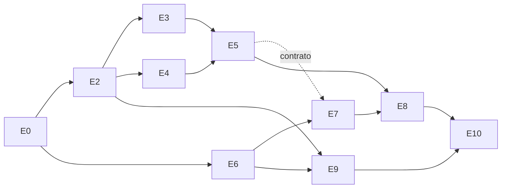

# Roadmap

Fases 0–6 de wasichai-learning con su objetivo, entregables, épicas, dependencias, riesgos y criterio de aceptación
(los de la sección 21 de la especificación). Los requisitos que cada fase cubre están en [`requirements.md`](requirements.md)
y se citan por identificador.

**Una fase no se completa por crear archivos.** Se da por cumplida cuando su criterio de aceptación se verifica
ejecutando las pruebas y los recorridos indicados, en local y en CI, y el resultado queda registrado en
[`docs/HISTORY.md`](../HISTORY.md). Un requisito pasa a `implementado` con las mismas condiciones.

## Resumen

| Fase | Objetivo                                                                                   | Estado                                                                       |
| ---- | ------------------------------------------------------------------------------------------ | ---------------------------------------------------------------------------- |
| F0   | Investigación y arquitectura                                                               | completada (épicas E0, E1)                                                   |
| F1   | Esqueleto ejecutable y primer incremento: catálogo público con carga y créditos propuestos | completada (2026-10-28): épicas E2–E10, 42 requisitos implementados          |
| F2   | LMS básico: aula, matrícula, unidades, lecciones, recursos y progreso                      | criterio cumplido (2026-10-28): épicas E12–E16; pendientes a F3/F4/F6 (#103) |
| F3   | Evaluaciones y operación docente                                                           | cumplida (2026-10-31): épicas E18–E23; pendientes en #183 y #231             |
| F4   | Estudio editorial e importador AsciiDoc                                                    | integrada (2026-10-31): épicas E24–E28; criterio pendiente (#179)            |
| F5   | IA y multimedia                                                                            | planificada                                                                  |
| F6   | Calidad, reputación y despliegue                                                           | planificada                                                                  |

Las épicas viven en [wasichai/elearning-backend](https://github.com/wasichai/elearning-backend/issues); los pasos de
frontend, en [wasichai/elearning-frontend](https://github.com/wasichai/elearning-frontend/issues). Cada paso es un
sub-issue que se cierra con su PR. Las fases F5 y F6 aún no tienen issues: sus épicas se crean al planificar cada fase.

## F0 — Investigación y arquitectura

**Objetivo.** Diseño respaldado por código y documentación reales de Wasichai, y un plan ejecutable.

**Épicas.**

- [E0 Entorno y prerrequisitos (#1)](https://github.com/wasichai/elearning-backend/issues/1):
  [E0.1 wrapper de Gradle 9.8.2 (#2, cerrado)](https://github.com/wasichai/elearning-backend/issues/2),
  [E0.2 commit inicial, Node 26 y yarn 1 (frontend #1)](https://github.com/wasichai/elearning-frontend/issues/1),
  [E0.3 acceso a GitHub Packages (#3)](https://github.com/wasichai/elearning-backend/issues/3).
- [E1 Documentación de Fase 0 (#4)](https://github.com/wasichai/elearning-backend/issues/4):
  [E1.1 gobierno del repositorio (#5)](https://github.com/wasichai/elearning-backend/issues/5),
  [E1.2 repositorios de referencia (#6, cerrado)](https://github.com/wasichai/elearning-backend/issues/6),
  [E1.3 arquitectura y modelo de dominio (#7)](https://github.com/wasichai/elearning-backend/issues/7),
  [E1.4 ADR 0001–0010 (#8)](https://github.com/wasichai/elearning-backend/issues/8),
  [E1.5 requisitos y roadmap (#9)](https://github.com/wasichai/elearning-backend/issues/9),
  [E1.6 seguridad, IA, operación, pruebas y licencias (#10)](https://github.com/wasichai/elearning-backend/issues/10).

**Entregables.** [`docs/research/reference-repositories.md`](../research/reference-repositories.md),
[`docs/architecture/`](../architecture/overview.md), [`docs/adr/`](../adr/README.md), este roadmap y
[`requirements.md`](requirements.md), [`docs/security/`](../security/README.md), [`docs/ai/`](../ai/README.md),
[`docs/operations/`](../operations/README.md), [`docs/testing/`](../testing/README.md),
[`docs/legal/licensing.md`](../legal/licensing.md), [`docs/development/getting-started.md`](../development/getting-started.md).

**Dependencias.** Ninguna previa. E0.3 requiere que el usuario conceda `read:packages` a su token.

**Criterio de aceptación.**

- Cada afirmación sobre Wasichai, los manuales o versiones cita su origen (ruta, commit o registro) o se marca «a
  verificar».
- Las dependencias `wasichai:wasichai-bom:1.6.0` y `@wasichai/core@1.3.0` se resuelven realmente (E0.3).
- Las épicas de F1 existen con pasos y criterios de aceptación verificables.

**Riesgos.** Sin `read:packages` no se puede construir nada (bloquea F1). Ningún repositorio `wasichai/*` declara
licencia: no bloquea el desarrollo, sí una publicación open source real ([`licensing.md`](../legal/licensing.md)).

## F1 — Esqueleto ejecutable y primer incremento (catálogo público)

**Objetivo.** Backend y frontend corren, se comunican, la persistencia funciona y las comprobaciones pasan, con un
corte vertical real: PostgreSQL → modelo Wasichai → API → pantalla → pruebas.

**Épicas.**

- [E2 Esqueleto backend (#11)](https://github.com/wasichai/elearning-backend/issues/11): #12 build y aplicación, #13 Compose, #14 arranque y arquitectura.
  Requisitos: RNF-ARQ-01/02/03/07, RF-ROL-02, RNF-OPS-01.
- [E3 Modelo LMS y aprovisionamiento (#15)](https://github.com/wasichai/elearning-backend/issues/15):
  #16 modelo y roles, #17 script, #18 base de integración, #19 demo A/B/C.
  Requisitos: RF-ACA-01/02, RF-ROL-01, RNF-ARQ-04, RNF-OSS-03/04.
- [E4 Carga y créditos (#20)](https://github.com/wasichai/elearning-backend/issues/20): #21 carga, #22 políticas ECTS y SCH.
  Requisitos: RF-CRE-01…06.
- [E5 API pública de catálogo (#23)](https://github.com/wasichai/elearning-backend/issues/23): #24 cadena pública, #25 listado, #26 ficha, #27 OpenAPI.
  Requisitos: RF-CAT-01…07, RNF-SEG-01/02/04/06, RNF-ARQ-06.
- [E6 Esqueleto frontend (#28)](https://github.com/wasichai/elearning-backend/issues/28): frontend #2 proyecto Vite, #3 `WasichaiApp`.
  Requisitos: RNF-ARQ-05, RNF-UX-01.
- [E7 `catalogModule` (#29)](https://github.com/wasichai/elearning-backend/issues/29):
  frontend #4 contrato y cliente, #5 catálogo, #6 ficha, #7 fronteras e i18n.
  Requisitos: RF-CAT-05, RNF-UX-02…05, RF-ADM-01.
- [E8 Pruebas E2E (#30)](https://github.com/wasichai/elearning-backend/issues/30): frontend #8 API simulada, #9 smoke contra backend real.
  Requisitos: RNF-UX-03/04.
- [E9 Integración continua (#31)](https://github.com/wasichai/elearning-backend/issues/31): #32 CI backend, frontend #10 CI frontend.
  Requisitos: RNF-OPS-02, RNF-SEG-05.
- [E10 Revisión y cierre (#33)](https://github.com/wasichai/elearning-backend/issues/33): #34 revisión de código y seguridad, #35 historial e informe.
  Requisitos: DoD.

Pasos de frontend: [#2](https://github.com/wasichai/elearning-frontend/issues/2),
[#3](https://github.com/wasichai/elearning-frontend/issues/3), [#4](https://github.com/wasichai/elearning-frontend/issues/4),
[#5](https://github.com/wasichai/elearning-frontend/issues/5), [#6](https://github.com/wasichai/elearning-frontend/issues/6),
[#7](https://github.com/wasichai/elearning-frontend/issues/7), [#8](https://github.com/wasichai/elearning-frontend/issues/8),
[#9](https://github.com/wasichai/elearning-frontend/issues/9), [#10](https://github.com/wasichai/elearning-frontend/issues/10).
RNF-OSS-01/02/05 se cierran con E1.1 y E0.3 una vez verificados contra el esqueleto.

**Dependencias.**

E4 es dominio puro: solo necesita el build de E2. E7 puede avanzar con la API simulada en cuanto el contrato de E5
esté fijado; el smoke de E8 contra backend real necesita E5 terminado.

**Reutiliza de Wasichai.** Identidad y permisos, Custom Objects (catálogo, cursos, versiones, ediciones), auditoría,
`ProblemDetail`, `WasichaiIntegrationTest`, registro de módulos y componentes de `@wasichai/ui`.
**Nuevo.** Cadena de seguridad pública acotada, dominio de carga y créditos, API y DTO del catálogo, `catalogModule`.

**Criterio de aceptación.** Con `docker compose up`, `./gradlew bootRun` y `yarn dev`, un visitante anónimo busca,
filtra y ordena cursos publicados y abre su ficha con temario, ediciones, docentes, carga y créditos _propuestos_;
los cursos en borrador no aparecen ni por URL; todo lo demás bajo `/api/lms/**` exige sesión; build, ktlint,
pruebas unitarias, de integración y de arquitectura, lint, tipos, Vitest, build de frontend y E2E pasan en local y en
CI.

**Riesgos.** La API exacta de `RecordService` y del aprovisionamiento por REST se confirma leyendo el código al
implementar. springdoc 3.x con Jackson 3 y la configuración de Wasichai no tiene precedentes (alternativa: contrato a
mano, ADR-0008). La cadena `@Order(-1)` debe limitarse a `GET /api/lms/public/**` sin abrir nada más.

## F2 — LMS básico

**Objetivo.** Un estudiante se matricula, navega su curso por unidades, consume lecciones y recursos y conserva su
progreso entre sesiones y dispositivos.

**Entregables.** Matrícula con capacidad y ventana; versión publicada inmutable; unidades, lecciones y recursos
versionados con binarios en almacenamiento de objetos; aula (`classroomModule`) con navegación persistente; progreso
y eventos de aprendizaje; creación de borradores por creadores; alcance por recurso y pruebas IDOR.

**Requisitos.** RF-CAT-08, RF-ACA-03…07, RF-AUL-01…07, RF-ROL-03…05, RF-CON-01/02, RF-ADM-02, RNF-ARQ-08,
RNF-SEG-03/07, RNF-UX-06…08.

**Dependencias.** F1 completa (modelo, permisos, esqueletos, CI).

**Reutiliza de Wasichai.** Custom Objects (`Enrollment`, unidades, lecciones, recursos), `RecordWriteGuard` y
`RecordReadScope`, `wasichai-files` con `FileStore` S3 (servicio S3 compatible local en Compose), `Idempotency-Key`.
**Nuevo.** Tabla fija `lms` para eventos de aprendizaje de alto volumen (`ModuleMigration` orden 200), reglas de
progreso, `classroomModule`.

**Criterio de aceptación.** Recorridos E2E 1–4 de §20 (login de estudiante, matrícula, unidad y recurso, progreso)
sobre la semilla de demostración; pruebas IDOR en todos los endpoints con identificador.

**Estado (2026-10-28).** Criterio cumplido: recorridos 1–4 contra el backend real, en local y en CI (trabajo
`e2e-real` del frontend), y pruebas IDOR en matrícula, aula, eventos y archivos. Requisitos F2 implementados con su PR
en [requirements.md](requirements.md); los 16 que aún no cumplen su aceptación se siguen en
[#103](https://github.com/wasichai/elearning-backend/issues/103), repartidos por decisión de la dirección: RF-ROL-04, RF-ROL-03/05, RF-AUL-02…05, RF-ACA-05,
RF-ADM-02 y RNF-UX-06/08 a F3; RF-CON-01/02, RNF-SEG-07 y RNF-ARQ-08 a F4; RF-CAT-08 a F6.
Diseño: ADR-0012 y ADR-0013.

**Riesgos.** La forma exacta de componer `RecordReadScope` con asignaciones por recurso está a verificar en el código
de Wasichai. Los eventos de vídeo pueden ser muchos: se define el volumen esperado antes de elegir tabla fija frente a
Custom Object. Al no existir el tipo `JSON` en Wasichai, los datos estructurados flexibles requieren diseño
explícito. Acceso a binarios ajenos por URL directa.

## F3 — Evaluaciones y operación docente

**Objetivo.** Un curso corto completo funciona de punta a punta: sesiones, asistencia, evaluaciones, calificación,
finalización y certificado.

**Entregables.** Cuestionarios con los tipos de §6.6, intentos sobre instantánea, entregas y rúbricas, laboratorios,
sesiones recurrentes y asistencia, adaptador de videoconferencia, vistas del docente (`teachingModule`), reglas de
finalización, certificados, notificaciones de calendario y publicación.

**Requisitos.** RF-CAT-09, RF-ACA-08/09, RF-AUL-08/09, RF-SES-01…05, RF-EVA-01…08, RF-LAB-01…03, RF-ADM-03,
RNF-OPS-03, RNF-OSS-06; además RF-ROL-03…05, RF-AUL-02…05, RF-ACA-05, RF-ADM-02, RNF-UX-06/08 (de F2).

**Dependencias.** F2 (matrícula, progreso, alcance por recurso).

**Reutiliza de Wasichai.** `wasichai-notifications` (correo y SSE), `wasichai-automation` (recordatorios y cierres
programados en cola persistente), `wasichai-documents` (certificados congelados al emitir), `wasichai-files`
(entregas), auditoría.
**Nuevo.** Tablas fijas `lms` para instantáneas de evaluación e intentos, motor de calificación, recurrencia de
sesiones con zonas IANA, puerto de videoconferencia, `teachingModule`, buzón de correo local en Compose.

**Criterio de aceptación.** Recorridos E2E 5–7 y 13 de §20 (evaluación, resultado, el docente ve solo lo permitido,
sin permiso no se puede) y un curso de demostración corto completado de principio a fin con certificado emitido.

**Estado (2026-10-31).** Criterio cumplido: el curso corto `CORTO-101` se completa de principio a fin con su certificado
emitido y verificado, por la API ([#161](https://github.com/wasichai/elearning-backend/pull/161)) y en el navegador
contra el backend real, con los recorridos 5, 6, 7 y 13 y el aviso por correo en Mailpit, en local y en CI (trabajo
`e2e-real`, [front#61](https://github.com/wasichai/elearning-frontend/pull/61)). Épicas E18–E23
([#112](https://github.com/wasichai/elearning-backend/issues/112) … [#130](https://github.com/wasichai/elearning-backend/issues/130));
diseño en ADR-0016, ADR-0017, ADR-0019 y ADR-0020. El hallazgo de su revisión que queda (M4, en parte; L4 lo cerró #232) se
siguen en [#183](https://github.com/wasichai/elearning-backend/issues/183); los requisitos F3 que aún no cumplen su
aceptación (RF-CAT-09, RF-ACA-08, RF-AUL-08/09, RF-LAB-01/03, RF-ADM-03 y RNF-OSS-06) llevan un «Avance» en
[requirements.md](requirements.md) y se siguen en [#231](https://github.com/wasichai/elearning-backend/issues/231).

**Riesgos.** Consistencia entre registros de Wasichai y tablas fijas propias en una misma operación (frontera
transaccional a verificar). Horario de verano en sesiones recurrentes. `wasichai-documents` no tiene motor PDF en el
servidor: el formato del certificado puede necesitar un generador aparte. Exposición prematura de soluciones.

## F4 — Estudio editorial

**Objetivo.** Preparar, revisar, aprobar y publicar contenido sin alterar lo que los estudiantes ya consumen.

**Entregables.** Versionado de materiales con fuente canónica y artefactos, importador AsciiDoc por etapas
(ADR-0010), generación HTML y PDF asíncrona, estudio del creador (`studioModule`), bandeja del revisor
(`reviewModule`) con diferencias y comentarios por sección, aprobación sin autoaprobación, publicación inmutable.

**Requisitos.** RF-CON-03…07, RF-IMP-01…05, RF-ROL-06, RNF-ARQ-09, RNF-SEG-08; además RF-CON-01/02, RNF-SEG-07, RNF-ARQ-08 (de F2).

**Dependencias.** F2 (versiones y recursos); F3 no es requisito previo salvo para publicar evaluaciones.

**Reutiliza de Wasichai.** `wasichai-workflow` (estados editoriales en el registro), `wasichai-automation`
(trabajos de importación y generación), `wasichai-files` (artefactos), auditoría.
**Nuevo.** Analizador del grafo `include::`, informe de importación, Asciidoctor y asciidoctor-pdf en contenedor,
cálculo de diferencias entre versiones, `studioModule` y `reviewModule`.

**Criterio de aceptación.** Recorridos E2E 8–12 de §20 (crear y editar borrador, enviar a revisión, revisar y pedir
cambios, aprobar, publicar, visible al estudiante); importación de un capítulo de SRTM y uno de SGSPE con informe
y trazas `repositorio@sha:ruta#ancla`; publicar v2 no altera v1 ni el progreso sobre v1.

**Riesgos.** Que `wasichai-workflow` exprese la revisión independiente está a verificar. Ejecutar Asciidoctor es un
proceso externo y bloqueante (aislamiento y límites). Sin licencia en los manuales, la demo no puede redistribuir su
texto: el importador se prueba sobre referencias y fragmentos propios. SSRF en orígenes remotos.

## F5 — IA y multimedia

**Objetivo.** Producir una unidad demostrativa desde un brief o una fuente, validada automáticamente, revisada por
personas y publicada solo tras su aprobación. Diseño en [`docs/ai/README.md`](../ai/README.md).

**Entregables.** Canalización editorial con brief, análisis de fuentes, diseño pedagógico y borrador; `AgentRun`
trazable; validaciones automáticas; doble determinista; comparación de modelos; guiones, subtítulos y render
Remotion asíncrono con validación del artefacto.

**Requisitos.** RF-IA-01…10, RF-MED-01…04, RNF-SEG-09.

**Dependencias.** F4 (flujo editorial, bandeja y publicación: la IA solo produce borradores para ese flujo).

**Reutiliza de Wasichai.** `wasichai-agent` (Embabel 1.5.3 y sus SPI `AgentAccessPolicy`, `AgentResultFilter`,
`AgentRunListener`), `wasichai-automation` (trabajos persistentes, reintentos), `wasichai-files`, `wasichai-workflow`.
**Nuevo.** La canalización editorial (el agente de Wasichai es de preguntas con herramientas de solo lectura), el
registro extendido de ejecuciones, el trabajador de render Remotion (Node y navegador sin interfaz, fuera de la JVM)
y los informes de comparación.

**Criterio de aceptación.** Una unidad de demostración generada con el doble determinista y, si hay credenciales,
con un proveedor real, pasa las validaciones, la revisión humana y se publica; su vídeo se renderiza y valida; la
suite completa pasa sin claves de proveedor.

**Riesgos.** Inyección de instrucciones desde las fuentes; coste y no determinismo de los modelos; que los SPI de
`wasichai-agent` encajen con una canalización editorial está a verificar; consumo de CPU y memoria del render;
cambios de API en Embabel.

## F6 — Calidad, reputación y despliegue

**Objetivo.** Producto instalable, mantenible y auditable.

**Entregables.** Valoraciones y feedback con moderación, perfiles e indicadores con criterios publicados, políticas de
crédito configurables y aprobación humana, lista de espera, informes, salud de procesos, endurecimiento de seguridad
y privacidad, auditoría de accesibilidad, mediciones de rendimiento, copias de seguridad, despliegue k3s, regresión
completa y licencia (si el titular la autoriza).

**Requisitos.** RF-ACA-10, RF-CRE-07/08, RF-REP-01…06, RF-ADM-04/05, RNF-SEG-10…12, RNF-OPS-04/05, RNF-OSS-07; además RF-CAT-08 (de F2).

**Dependencias.** F3 para valoraciones de docentes; F4 para valoraciones de recursos; F5 para los indicadores de la
canalización.

**Reutiliza de Wasichai.** Auditoría, notificaciones, formularios y vistas de administración.
**Nuevo.** Valoraciones y reglas anti-duplicado, métricas, administración de políticas de crédito, procedimientos de
copia y restauración, manifiestos de despliegue.

**Criterio de aceptación.** Los 13 recorridos E2E de §20 pasan contra un despliegue k3s real; una restauración de copia
de seguridad se ensaya y documenta; cada indicador publicado tiene definición y muestra mínima.

**Riesgos.** Métricas manipulables o con muestras pequeñas; operación de k3s sin experiencia previa en el proyecto;
la ausencia de licencia en Wasichai puede impedir la publicación open source aunque el producto esté listo.
